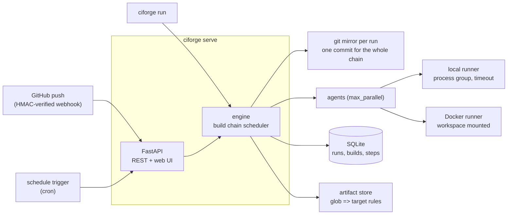

# CIForge

[](https://github.com/RaktimChandra/CIForge/actions/workflows/ci.yml)

A small CI orchestrator built to understand how TeamCity-style CI works inside: **build
configurations** in a YAML file kept in the repository, **build chains** (snapshot
dependencies), **artifact dependencies**, **parameters**, **VCS (GitHub push) and schedule
triggers**, **local and Docker runners**, a REST API and a web UI.

It is deliberately small (about 1,500 lines of Python, 983 statements) and tested to 92 % line coverage, so every concept is
readable in one sitting. It is not a replacement for a production CI server — see
[Limits](#limits).



## A pipeline

```yaml
version: 1
project: hello
params: { greeting: hello }
triggers:
  - { type: vcs, branches: [main, "release/*"] }
  - { type: schedule, cron: "0 2 * * *" }
builds:
  compile:
    steps: [{ name: build, run: 'mkdir -p out && echo "%greeting% from %vcs.commit%" > out/app.txt' }]
    artifacts: ["out/** => bin"]
  test:
    depends_on: [compile]                                   # snapshot dependency
    artifacts_from: [{ build: compile, paths: ["bin/**"] }] # artifact dependency
    runner: { type: docker, image: alpine:3.20 }
    steps: [{ name: check, run: grep -q hello bin/app.txt }]
```

Run `test` and CIForge runs its chain — `compile`, then `test` — on **one commit**, hands
`bin/app.txt` from `compile` to `test`, and stops the chain if `compile` fails. The full
reference is [docs/CONFIG.md](docs/CONFIG.md).

## Quick start

Needs Python 3.12+ and git (and Docker for the Docker runner).

```bash
pip install -e ".[dev]"
ciforge validate examples/hello/.ciforge.yml
ciforge graph examples/hello/.ciforge.yml          # Mermaid flowchart of the chain
ciforge run examples/hello/.ciforge.yml --source . # run every build on this repo's HEAD
ciforge run examples/hello/.ciforge.yml --source . -b test -p greeting=hi
```

As a server, with the web UI on http://127.0.0.1:8111:

```bash
ciforge serve --project hello=examples/hello/.ciforge.yml
curl -X POST localhost:8111/api/projects/hello/runs -H 'content-type: application/json' -d '{"builds":["test"]}'
```

Or with Docker Compose: `docker compose up --build`. GitHub webhooks: point a repository
webhook at `/api/webhooks/github/<project>` (content type JSON) and set the same secret in
`CIFORGE_WEBHOOK_SECRET`; requests without a valid `X-Hub-Signature-256` are rejected. The API
is listed in [docs/API.md](docs/API.md).

## What it does, precisely

| Concept | Behaviour |
|---|---|
| Build chain | `depends_on` builds run first, on the same commit; independent builds run in parallel up to `max_parallel` |
| Failure | a failed build cancels its dependents (reason recorded) unless they set `run_if: always`; other branches of the graph continue |
| Steps | run in order; the first failing step ends the build unless `continue_on_error`; `fail_on_text` fails a green exit whose log contains a marker |
| Timeouts | per step and per build; the whole process group (or the container) is killed |
| Parameters | `%name%` from pipeline → build → run (`--param`) → built-ins (`%vcs.commit%`, `%ciforge.run.id%`, …); `%env.X%`; unknown references are rejected when the file is loaded |
| Secrets | values of the listed environment variables are replaced by `***` in every log |
| Artifacts | TeamCity rules `glob => target`; the path below the first wildcard is kept; downloads are protected against path traversal |
| Sources | each run mirrors the repository once; every build checks out the same commit into its own workspace |
| Cancel | stops the running step (kills it) and cancels everything not started |

## Tests

```bash
ruff check src tests && mypy && pytest
```

33 tests: configuration validation (cycles, unknown references, parameters), parameter
substitution and masking, artifact rules, webhook signatures, branch and cron matching, and
the engine end to end on real git repositories — chains, failure propagation, parallelism,
timeouts that kill child processes, cancellation, pinned commits, the Docker runner — plus the
REST API, the webhook endpoint and the CLI. Measured results are in [RESULTS.md](RESULTS.md).

## Limits

One server process, SQLite, no agent pool across machines, no user accounts or permissions,
no log streaming (the UI refreshes), no build cache. The design notes in
[DESIGN.md](DESIGN.md) explain each choice and what a production version would change.

## Licence

MIT © 2026 Raktim Chandra
